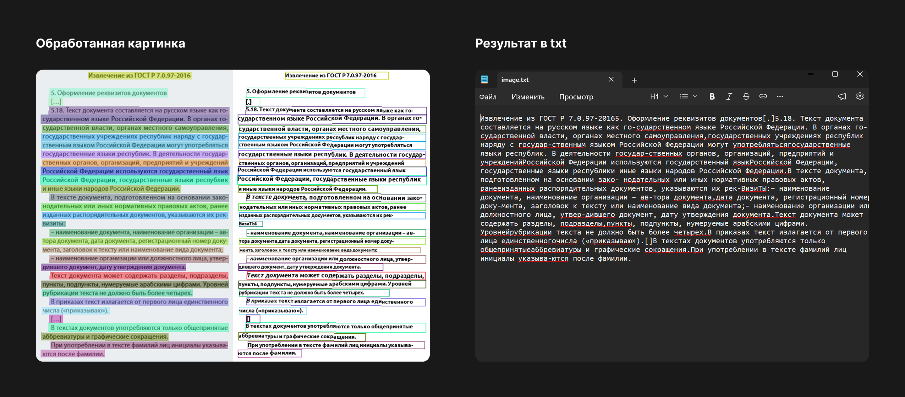
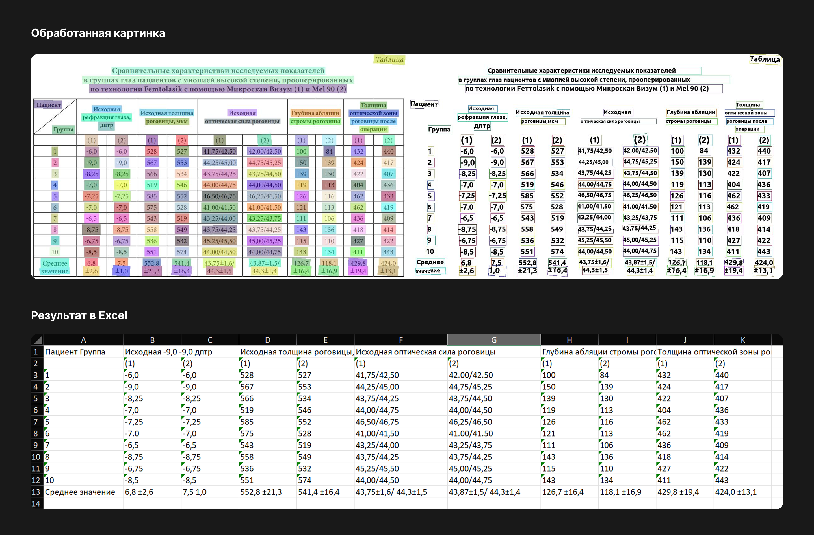

# Scan to Text

Консольное Python-приложение для распознавания текста и таблиц
на изображениях с помощью PaddleOCR.

**Проект находится в разработке.** Сейчас реализована консольная
версия. В дальнейшем планируется интерфейс для загрузки изображений,
просмотра, редактирования и сохранения результатов.

Это **вторая итерация проекта**. Первая версия использовала Tesseract OCR.
В текущей реализации были переработаны структура приложения,
пользовательский сценарий и обработка результатов на базе PaddleOCR.

## Режимы работы

### Распознавание текста

Используется `PaddleOCR`: программа находит текстовые области
на изображении и распознаёт их содержимое.

Результат можно вывести в консоль и сохранить:
- в JSON — текст, координаты и оценки уверенности;
- в изображение с разметкой найденных областей.

### Распознавание таблиц

Используется `TableRecognitionPipelineV2`: программа определяет
таблицы, распознаёт текст и восстанавливает структуру ячеек.

Результат можно сохранить:
- в Excel — XLSX;
- в HTML;
- в JSON;
- в изображения с разметкой.

Доступные форматы зависят от выбранного режима.
Экспорт в Excel предназначен для таблиц и недоступен
в режиме обычного распознавания текста.

## Возможности текущей реализации

- Два режима: текст и таблицы.
- Распознавание русского и английского текста.
- Обработка одного или нескольких изображений.
- Постепенное получение результатов через `predict_iter()`.
- Вывод и сохранение результатов распознавания.

## Примеры работы

### Распознавание текста

Пример картинки и распознанного текста.

### Распознавание таблицы

Пример таблицы и результата экспорта в Excel.

## Планируется

- Интерфейс для загрузки одного или нескольких изображений.
- Редактирование и копирование текста.
- Сохранение текста в TXT, PDF и Word.
- Расширение набора примеров для проверки качества и скорости.

## Технологии и версии

Проект разрабатывается и проверяется на **Python 3.12, Windows 11**.

Основные зависимости:

| Пакет | Версия | Назначение |
|---|---|---|
| `paddlepaddle` | `3.2.2` | Выполнение моделей на CPU |
| `paddleocr[doc-parser]` | `3.7.0` | Распознавание текста и структуры таблиц |
| `python-docx` | `1.2.0` | Работа с Word для дальнейшего развития экспорта |

Версия PaddlePaddle `3.2.2` выбрана после проверки CPU-ускорения
oneDNN. Версия `3.3.0` вызывала
ошибку при включённом `enable_mkldnn`.

## Используемые модели

Для распознавания текста:
- `PP-OCRv5_server_det` — поиск текстовых областей;
- `eslav_PP-OCRv5_mobile_rec` — распознавание текста.

Для восстановления структуры таблиц:
- `SLANet_plus` — в режимах таблиц с границами и без границ.

При первом использовании отсутствующие модели скачиваются автоматически.
При последующих запусках используются файлы из локального кеша.

Распознавание выполняется на компьютере пользователя.

## Текущие ограничения

- Качество зависит от изображения и выбранных моделей.
- Распознанный текст и структуру таблиц необходимо проверять.
- Обработка таблиц требует больше времени и ресурсов, чем обычный OCR.
- Подготовка моделей при запуске занимает дополнительное время.
- Интерфейс и дополнительные форматы экспорта пока находятся в планах.